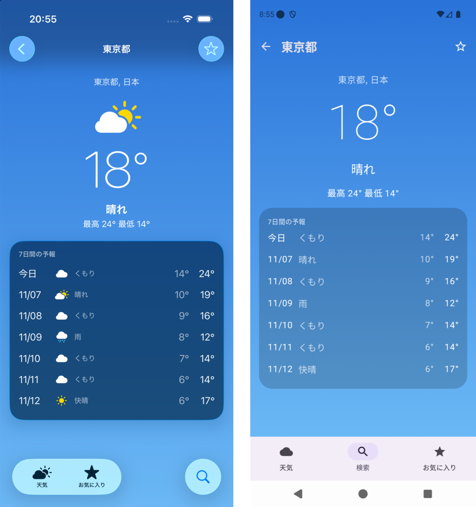

# reflex-native-app-demo

[English](README.md) | 日本語

Shopify の [Reflex](https://shopify.engineering/reflex) を、ネイティブ（Swift と Kotlin）でそのまま試した検証用アプリです。React Native 版の [reflex-expo-app](https://github.com/kazutoyo/reflex-expo-app) と同じ天気アプリを作りました。

- 現在地の天気、都市検索、お気に入りの3タブ。API は [Open-Meteo](https://open-meteo.com/)（API キー不要）
- iOS：SwiftUI（iOS 26 の Liquid Glass）、CoreLocation、UserDefaults
- Android：Jetpack Compose（Material 3）、LocationManager、SharedPreferences



## 概要

Reflex の考え方は「コードではなくテストを共有する」です。Core は Swift と Kotlin で2回書き、振る舞いのテストは TypeScript で1つだけ書いて両方に流します。

| Reflex | このリポジトリ |
|---|---|
| UI を持たない Core（Swift パッケージ / JVM モジュール） | `ios/Sources/WeatherCore`（UIKit・SwiftUI・CoreLocation を import しない）、`android/core`（`android.*` を使わない） |
| Elm 風の ViewModel（Action in / State out） | 画面ごとの ViewModel。状態を変えるのは `update` だけで、外から触れるのは `send` だけ |
| サービスのコンストラクタ注入 | `Deps`（HTTP、位置情報、保存）と `Navigator`。DI フレームワークは使わない |
| ナビゲーションも Core の状態 | `AppRoot` がタブとタブごとのスタックを持つ。「今の画面」はスタックの一番上 |
| Introspection（name / state / actions / child） | `Node`。ナビゲーターが `Back` と `SelectTab` を貸す |
| CLI（`ls` / `do`、NDJSON） | `weather-cli`（Swift、macOS）と `cli`（Kotlin、JVM）。どちらも標準入出力で同じ NDJSON を話す |
| 開発ビルドの中の小さなサーバー | `InspectorServer`（両アプリ）。同じ NDJSON を TCP の 8765 番で話す |
| TS の振る舞いテスト（Bun） | `tests/`。`PLATFORM=ios / android / rn` で相手を切り替える |

## 構成

```
fixtures/   Open-Meteo の実レスポンス（3つのプラットフォームで共有）
tests/      振る舞いテスト（Bun）、SDK、人とエージェントが使う CLI
ios/
├── Package.swift
├── Sources/WeatherCore/   Core（ViewModel、AppRoot、Open-Meteo、Introspection）
├── Sources/WeatherCLI/    CLI とフェイク（フィクスチャ、位置情報、保存、ネットワーク遮断）
└── App/                   SwiftUI のアプリ（xcodegen の project.yml）
android/
├── core/   Core（純粋な JVM モジュール）
├── cli/    CLI とフェイク
└── app/    Compose のアプリ
```

ViewModel の形は両方とも同じです（`WeatherViewModel` から抜粋）。

```swift
@MainActor @Observable public final class WeatherViewModel: ViewModel {
  public enum Action: Decodable { case appear, retry, openSettings, openSearch }
  static func update(_ state: State, _ msg: Msg) -> State { ... }   // 状態を変えるのはここだけ
  public func send(_ action: Action) async { ... }                  // 副作用は deps を呼び、結果を Msg として update に戻す
}
```

```kotlin
class WeatherViewModel internal constructor(private val deps: Deps, private val nav: Navigator) :
  ViewModel<WeatherState, WeatherAction, WeatherViewModel.Msg>(...) {
  override fun update(state: WeatherState, msg: Msg): WeatherState = ...
  override suspend fun send(action: WeatherAction) { ... }
}
```

state の JSON は Swift と Kotlin で同じ形にしています（`null` も書く、union は `status` で見分ける）。

## プロトコル

1 行に 1 つの JSON（NDJSON）。CLI もアプリ内のサーバーも同じ形で返します。

```
→ {"cmd":"launch","route":"/search","location":{"granted":false},"favorites":[1850147]}
→ {"cmd":"do","action":"Open","input":{"id":1850147}}
← {"ok":true,"path":"/cities/1850147","name":"City","state":{...},"actions":["Appear","Retry","ToggleFavorite","Back","SelectTab"],"env":{...}}
```

| コマンド | 内容 | CLI | アプリ |
|---|---|---|---|
| `launch` | アプリを作り直す。`route`（ディープリンク）、`favorites`、端末の環境を渡す | ○ | |
| `ls` | 今の画面の name / state / actions | ○ | ○ |
| `do` | アクションを送る。副作用が終わってから返す。今の画面にも親にもないアクションと、入力の型が違うアクションは断る | ○ | ○ |
| `env` | 端末の環境を変える（位置情報の許可、通信、天気コード）。アプリで使えるのは `http`（`offline` / `live`）と `weatherCode` だけ | ○ | ○ |
| `open` | ディープリンク | | ○ |

`env` はテスト用です。設定アプリの呼び出し回数、保存したお気に入り、HTTP の回数、ネットワークに出ようとした回数を返します。CLI はプロセスの外への HTTP をすべて止めていて（iOS は `URLProtocol`、JVM は `ProxySelector`）、1 回でも試みたらテストを落とします。

## 動かす

```bash
# Core と CLI
(cd ios && swift build)
(cd android && ./gradlew :cli:installDist)

# 振る舞いテスト（シミュレータ不要）
cd tests
bun install
bun run test:ios
bun run test:android
bun run test:rn        # ../reflex-expo-app（隣に clone する）の jest ハーネスで同じテストを流す
```

### CLI で操作する

```bash
cd tests
bun cli.ts --platform android --launch '{"route":"/search"}' do ChangeQuery '{"query":"Tokyo"}' do Submit do Open '{"id":1850147}'
```

```
$ do Open {"id":1850147}
  (11.0 ms)
  /cities/1850147  City
  state:   {"status":"loaded","city":{"id":1850147,"name":"東京都",...},"forecast":{...},"favorite":false}
  actions: Appear, Retry, ToggleFavorite, Back, SelectTab
```

`--connect` を付けると、動いているアプリ（開発ビルド）に同じコマンドを送れます。ボタンを押さずに、本物の画面が遷移します。

```bash
bun cli.ts --connect localhost:8765 do SelectTab '{"tab":"search"}' do ChangeQuery '{"query":"Tokyo"}' do Submit do Open '{"id":1850147}'
bun cli.ts --connect localhost:8765 env '{"weatherCode":71}' do Retry   # 本物の API の応答のまま、天気だけ雪にする
```

- iOS シミュレータ：ホストとネットワークを共有するので、そのまま `localhost:8765`
- Android エミュレータ：先に `adb forward tcp:8765 tcp:8765`

### アプリ

```bash
# iOS（xcodegen が必要）
cd ios/App && xcodegen generate
xcodebuild -project Weather.xcodeproj -scheme Weather -destination 'platform=iOS Simulator,name=iPhone 17 Pro' -derivedDataPath ../.build/xcode build

# Android
cd android && ./gradlew :app:installDebug
```

## わかったこと

### 同じテストが 3 つの実装を通る

同じ 21 本の振る舞いテストが、Swift・Kotlin・React Native のどれにも変更なしで通ります（ウォーム状態、M シリーズの Mac）。

| 相手 | 21 本の時間 | 内訳 |
|---|---|---|
| iOS（Swift の CLI） | 48ms | プロセスの起動を含む |
| Android（Kotlin の CLI） | 270ms | JVM の起動を含む |
| React Native（jest のハーネス） | 3.2 秒 | ほぼ jest の起動 |

テストは「どの画面にいて、何が見えていて、何ができるか」だけを見ます。そのため、RN からネイティブへ書き換えるとき（あるいはその逆）に、同じテストを移行の安全網として使えます。

RN 版を同じテストに合わせるために変えたのは 2 点だけでした。

- お気に入りの「天気を取れなかった」の表し方（`current: undefined / null` → `current` と `failed`）
- アクションの入力の検証（Reflex の入力スキーマに当たる。`Open` に `{"id":"tokyo"}` を送ると、画面に届く前に断る）

タブの切り替えと戻るは、ネイティブ版ではナビゲーターが貸すアクションです。RN 版ではアダプター（`reflex-expo-app/test/protocol.test.tsx`）が expo-router の遷移に置き換えています。

### ネイティブはナビゲーションを Core に持てる

RN 版では、Expo Router のナビゲーションが `_layout.tsx` の JSX の中にあるので、本物のレイアウトを描画するハーネスが必要でした。ネイティブ版はタブとスタックも Core の状態なので、View を作らずにアプリ全体を歩けます。

その代わり、View 側の遷移（スワイプで戻る、Android の戻るボタン、タブのタップ）を Core に戻す配線が要ります。SwiftUI は `NavigationStack(path:)` の Binding、Compose は Core のスタックをそのまま描いて `BackHandler` で `back()` を呼んでいます。

### 速さ

CLI で 7 操作（検索 → 詳細 → お気に入り → 戻る → お気に入りタブ）を流すと、プロセスの起動込みで iOS が 0.16 秒、Android が 0.23 秒でした。1 操作は 0.1〜11ms です。RN 版の app-cli は、jest の起動のため 1 回あたり約 3 秒かかります。

動いているアプリへの `do` は、シミュレータで 5〜250ms（実ネットワークの検索は約 1 秒）でした。

### 実機（シミュレータ・エミュレータ）でしか見つからなかったもの

- **Android エミュレータで位置が返ってこない**：Fused Provider が応答せず、読み込み中のままになった。端末が最後に取得した位置を先に使い、15 秒で諦めてエラーにした
- **SwiftUI の背景が細い帯になる**：読み込み中は中身が細いので、`ScrollView` の背景も細くなった

どちらも Core の振る舞いではなく、プラットフォームの実装と見た目の問題です。Reflex と同じく、振る舞いはヘッドレスで、見た目と配線は実機で確かめる分担になります。

## 未対応・今後

- 入力のスキーマは手で書いた型の decode です（Swift は `Decodable`、Kotlin は `@Serializable`）。Reflex のようなマクロでの生成はしていません。
- Kotlin の Core は、JSON と非同期のために `kotlinx.serialization` と `kotlinx.coroutines` を使っています。Reflex 自体（ViewModel の基底クラスと Introspection のプロトコル）は第三者の依存を持たないそうです。
- アプリ内のサーバーには `launch` がなく、`env` は `http` と `weatherCode` だけです。位置情報の許可はアプリでは切り替えられません。
- Android の実機と、iOS の実機では確認していません。
