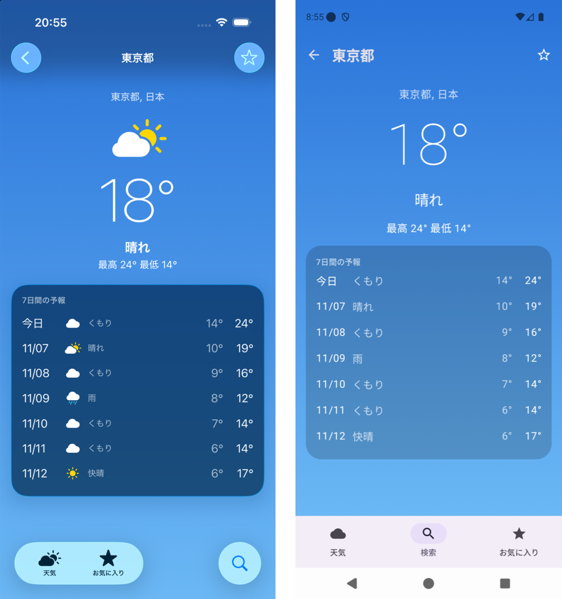

# reflex-native-app-demo

English | [日本語](README.ja.md)

An experiment in applying Shopify's [Reflex](https://shopify.engineering/reflex) to native code (Swift and Kotlin), following the article as closely as possible. It is the same weather app as the React Native version, [reflex-expo-app](https://github.com/kazutoyo/reflex-expo-app).

- Three tabs: weather at the current location, city search, and favorites. API: [Open-Meteo](https://open-meteo.com/) (no API key)
- iOS: SwiftUI (iOS 26 Liquid Glass), CoreLocation, UserDefaults
- Android: Jetpack Compose (Material 3), LocationManager, SharedPreferences
- The UI text is in Japanese.



## Overview

The core idea of Reflex is "share the tests, not the code". The core is written twice, in Swift and in Kotlin. The behavior tests are written once, in TypeScript, and run against both.

| Reflex | This repository |
|---|---|
| A core with no UI (Swift package / JVM module) | `ios/Sources/WeatherCore` (never imports UIKit, SwiftUI, or CoreLocation) and `android/core` (never uses `android.*`) |
| A strict Elm-style ViewModel (action in, state out) | One ViewModel per screen. Only `update` changes state; the only public entry point is `send` |
| Services injected through the constructor | `Deps` (HTTP, location, storage) and `Navigator`. No DI framework |
| Navigation is core state too | `AppRoot` owns the tabs and one stack per tab. The current screen is the top of the stack |
| Introspection (name / state / actions / child) | `Node`. The navigators lend `Back` and `SelectTab` |
| CLI (`ls` / `do`, NDJSON) | `weather-cli` (Swift, macOS) and `cli` (Kotlin, JVM). Both speak the same NDJSON over stdin/stdout |
| A small server inside development builds | `InspectorServer` (both apps). Speaks the same NDJSON over TCP port 8765 |
| Behavior tests in TypeScript (Bun) | `tests/`. `PLATFORM=ios / android / rn` picks the target |

## Structure

```
fixtures/   Real Open-Meteo responses (shared by all three platforms)
tests/      Behavior tests (Bun), the SDK, and the CLI for people and agents
ios/
├── Package.swift
├── Sources/WeatherCore/   Core (ViewModels, AppRoot, Open-Meteo, Introspection)
├── Sources/WeatherCLI/    CLI and fakes (fixtures, location, storage, network guard)
└── App/                   SwiftUI app (xcodegen project.yml)
android/
├── core/   Core (a plain JVM module)
├── cli/    CLI and fakes
└── app/    Compose app
```

Both platforms share the same ViewModel shape (from `WeatherViewModel`):

```swift
@MainActor @Observable public final class WeatherViewModel: ViewModel {
  public enum Action: Decodable { case appear, retry, openSettings, openSearch }
  static func update(_ state: State, _ msg: Msg) -> State { ... }   // The only place that changes state
  public func send(_ action: Action) async { ... }                  // Side effects call deps and feed the results back to update as Msg
}
```

```kotlin
class WeatherViewModel internal constructor(private val deps: Deps, private val nav: Navigator) :
  ViewModel<WeatherState, WeatherAction, WeatherViewModel.Msg>(...) {
  override fun update(state: WeatherState, msg: Msg): WeatherState = ...
  override suspend fun send(action: WeatherAction) { ... }
}
```

State is encoded to the same JSON in Swift and Kotlin (`null` is written out, and unions are told apart by `status`).

## Protocol

One JSON object per line (NDJSON). The CLI and the in-app server return the same shape.

```
→ {"cmd":"launch","route":"/search","location":{"granted":false},"favorites":[1850147]}
→ {"cmd":"do","action":"Open","input":{"id":1850147}}
← {"ok":true,"path":"/cities/1850147","name":"City","state":{...},"actions":["Appear","Retry","ToggleFavorite","Back","SelectTab"],"env":{...}}
```

| Command | What it does | CLI | App |
|---|---|---|---|
| `launch` | Builds the app again. Takes `route` (deep link), `favorites`, and the device environment | ✓ | |
| `ls` | name / state / actions of the current screen | ✓ | ✓ |
| `do` | Sends an action and returns after its side effects finish. Rejects actions that neither the screen nor a parent offers, and inputs of the wrong type | ✓ | ✓ |
| `env` | Changes the device environment (location permission, network, weather code). The app takes only `http` (`offline` / `live`) and `weatherCode` | ✓ | ✓ |
| `open` | Deep link | | ✓ |

`env` is for tests. It reports how many times the Settings app was opened, the saved favorites, the number of HTTP requests, and the number of attempts to reach the network. The CLI blocks all HTTP leaving the process (`URLProtocol` on iOS, `ProxySelector` on the JVM), and a single attempt fails the test.

## Running

```bash
# Core and CLI
(cd ios && swift build)
(cd android && ./gradlew :cli:installDist)

# Behavior tests (no simulator)
cd tests
bun install
bun run test:ios
bun run test:android
bun run test:rn        # Runs the same tests in the jest harness of ../reflex-expo-app (clone it next to this repo)
```

### Driving the core from the CLI

```bash
cd tests
bun cli.ts --platform android --launch '{"route":"/search"}' do ChangeQuery '{"query":"Tokyo"}' do Submit do Open '{"id":1850147}'
```

```
$ do Open {"id":1850147}
  (11.0 ms)
  /cities/1850147  City
  state:   {"status":"loaded","city":{"id":1850147,"name":"東京都",...},"forecast":{...},"favorite":false}
  actions: Appear, Retry, ToggleFavorite, Back, SelectTab
```

With `--connect`, the same commands go to a running app (development build). The real screens navigate without a single tap.

```bash
bun cli.ts --connect localhost:8765 do SelectTab '{"tab":"search"}' do ChangeQuery '{"query":"Tokyo"}' do Submit do Open '{"id":1850147}'
bun cli.ts --connect localhost:8765 env '{"weatherCode":71}' do Retry   # Snow, with the real API response
```

- iOS Simulator: it shares the host's network, so use `localhost:8765` as is
- Android Emulator: run `adb forward tcp:8765 tcp:8765` first

### Apps

```bash
# iOS (requires xcodegen)
cd ios/App && xcodegen generate
xcodebuild -project Weather.xcodeproj -scheme Weather -destination 'platform=iOS Simulator,name=iPhone 17 Pro' -derivedDataPath ../.build/xcode build

# Android
cd android && ./gradlew :app:installDebug
```

## Findings

### The same tests pass on three implementations

The same 21 behavior tests pass unchanged on Swift, Kotlin, and React Native (warm runs, Apple silicon Mac).

| Target | 21 tests | Notes |
|---|---|---|
| iOS (Swift CLI) | 48ms | Includes process startup |
| Android (Kotlin CLI) | 270ms | Includes JVM startup |
| React Native (jest harness) | 3.2s | Mostly jest startup |

The tests only look at which screen you are on, what is visible, and what you can do. So when you rewrite an app from RN to native (or the other way around), the same tests work as a safety net for the migration.

Only two things in the RN version had to change to match these tests:

- How a favorite whose weather failed to load is represented (`current: undefined / null` → `current` and `failed`)
- Validation of action inputs (the equivalent of Reflex's input schema; sending `{"id":"tokyo"}` to `Open` is rejected before it reaches the screen)

Switching tabs and going back are actions lent by the navigators in the native version. In the RN version, an adapter (`reflex-expo-app/test/protocol.test.tsx`) maps them to expo-router navigation.

### Native code can keep navigation in the core

In the RN version, Expo Router's navigation lives in the JSX of `_layout.tsx`, so the harness has to render the real layouts. In the native version, tabs and stacks are core state too, so you can walk the whole app without creating any views.

The trade-off is wiring that feeds view-side navigation (swipe back, the Android back button, tapping a tab) back into the core. SwiftUI uses a `NavigationStack(path:)` binding. Compose draws the core's stack directly and calls `back()` from `BackHandler`.

### Speed

Running 7 operations through the CLI (search → detail → favorite → back → favorites tab) took 0.16s on iOS and 0.23s on Android, including process startup. Each operation takes 0.1–11ms. The RN version's app-cli takes about 3s per call because of jest startup.

`do` against a running app took 5–250ms in the simulator (about 1s for a search over the real network).

### Found only in the simulator / emulator

- **No location on the Android Emulator**: the Fused provider never answered, so the screen stayed in loading. The app now uses the last known position first and gives up with an error after 15 seconds
- **The SwiftUI background was a narrow strip**: while loading, the content is narrow, so the `ScrollView` background was narrow too

Neither is core behavior; both are platform wiring and visuals. As in Reflex, behavior is checked headlessly, and visuals and wiring on a device.

## Limitations and next steps

- Input schemas are hand-written type decoding (`Decodable` in Swift, `@Serializable` in Kotlin). They are not generated by macros as in Reflex.
- The Kotlin core uses `kotlinx.serialization` and `kotlinx.coroutines` for JSON and async. Reflex itself (the ViewModel base classes and the Introspection protocol) reportedly has no third-party dependencies.
- The in-app server has no `launch`, and its `env` takes only `http` and `weatherCode`. Location permission cannot be switched in the app.
- Not tested on physical Android or iOS devices.
